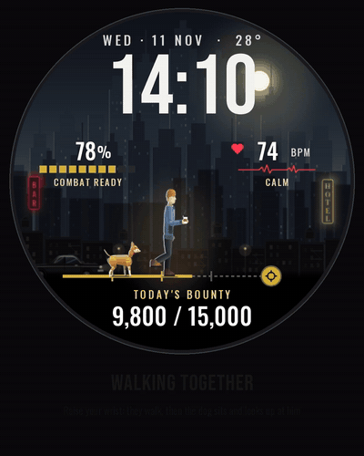
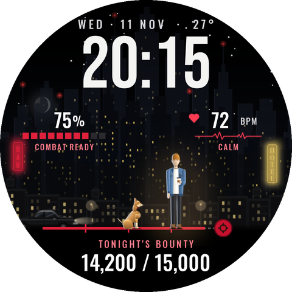
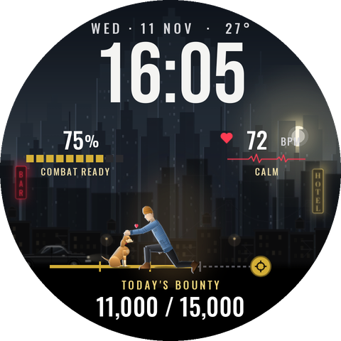

# On the Hunt 🎯 – a noir city watch face for Wear OS


Your steps are today's **bounty**. Your battery is your **health**. A guy with a coffee and his golden dog walk through a noir city whose skyscrapers rise behind the clock. The sun and moon cross the sky with the real time, the weather is real, and the two of them actually interact.

<p align="center"></p>

<p align="center">▶️ <a href="media/demo.mp4"><b>Watch the full feature walkthrough (1:37)</b></a>: every mode, tap, weather and the day-to-night sky, explained.</p>

Built in Google's **Watch Face Format**, so it works on **Galaxy Watch 4 → 8 / Ultra, Pixel Watch and other round Wear OS 4+ watches**.

---

## Features

| | |
|---|---|
| ⏱ **Big, readable time** | Bebas Neue with a soft shadow, date + current temperature, follows your 12/24 h setting |
| ❤️ **Health = battery** | Left edge: % + 10 health blocks · COMBAT READY → WOUNDED → CRITICAL · **RELOADING…** while charging |
| 💓 **Heart rate** | Right edge: live BPM, beating heart, ECG line · CALM → ON EDGE → ADRENALINE |
| 🎯 **Today's bounty** | Steps vs. your step goal; the two of them move along a gold trail with 25 / 50 / 75 % milestones |
| 🚶 **Raise your wrist** | They walk side by side; when they stop he turns to you, the dog sits and looks up at him, and he glances down at it |
| 👆 **Tap them** | One of four calm moves: the dog comes in for a **head scratch** · a **coin flip** the dog follows with its eyes · he kneels to **pat** it (it closes its eyes and wags) · a **sip of coffee** while the dog looks up at the cup |
| 🔔 **Notifications** | The dog stands, gives a small comic **"WOOF"** and looks at him; he looks down at it |
| 🎉 **Contract fulfilled** | Goal reached → fist pump, the target bursts into gold confetti, the dog bounces, then **+OVERTIME** steps |
| 🌆 **Full-height city** | Hazy skyscrapers rise behind the time; lit windows and red rooftop beacons at night; a classic black coupe parked on the street |
| ☀️🌙 **Sun & moon** | The sun arcs across the sky from 6 am to 6 pm (orange near the horizon); at night the moon crosses in **today's real phase** |
| 🌧 **Live weather** | Rain, thunderstorm (lightning), snow, fog and clouds from your real weather; the sun and moon hide in rain and fade behind clouds |
| 🌙 **Night mode** | Gold turns blood-red after sunset and it becomes *Tonight's bounty* |
| 🪫 **Reactions** | Charging → he sips his coffee · battery < 20 % → he slumps and the dog lies down · behind on steps → he leans on a lamp post ("BEHIND PACE") · BPM ≥ 120 → red glow |
| ⌚ **Shortcuts** | Tap the time → Alarm · tap heart rate → Heart rate |

| Day | Night | Rain | The pat | Contract fulfilled |
|---|---|---|---|---|
|  |  |  |  |  |

> Screenshots are renders of the face; on your wrist it's live and animated.

---

## Install

1. Download **`OnTheHunt-watchface-v2.6.apk`** from the [**Releases**](../../releases) page.
2. Follow **[INSTALL.md](INSTALL.md)**: about 10 minutes the first time. Do it **from your Android phone with a free app (no computer needed)**, or with one `adb install` command from Windows, macOS or Linux.
3. On the watch: touch and hold the face → swipe to **+ Add watch face** → **On the Hunt**.

**Requirements:** round Wear OS 4+ watch (Galaxy Watch 4 or newer on current software, Pixel Watch, etc.). Weather, moon phase and step goal come from your watch (Samsung Health / Google Fit and the weather service).

---

## Build it yourself

The watch face has **no code**; it's an XML file plus images and fonts.

```
watchface/src/main/
  AndroidManifest.xml
  res/raw/watchface.xml      ← the whole face (Watch Face Format v2)
  res/drawable/*.png         ← artwork (characters, dog, car, city, skies, sun, moon, effects)
  res/font/*.ttf             ← Bebas Neue, Oswald (SIL OFL)
tools/                       ← Python scripts that generate the XML and render the artwork
media/                       ← demo GIF / video
```

- Regenerate the XML: `python3 tools/make_watchface_xml.py`
- Re-render the artwork (Python, Pillow, Playwright + Chrome): see [tools/README.md](tools/README.md)
- Package with Android build tools (`aapt` or Gradle), then sign with **your own** key (`apksigner`).

Validate against the official schema from [google/watchface](https://github.com/google/watchface).

---

## Credits & licences

- **Design, characters, dog, car, city art:** © John Jitto M. Artwork licensed under **CC BY-NC-SA 4.0** (see [LICENSE-ARTWORK](LICENSE-ARTWORK)): share and remix with credit, not for sale.
- **Scripts & XML:** MIT (see [LICENSE](LICENSE)).
- **Fonts:** [Bebas Neue](https://fonts.google.com/specimen/Bebas+Neue) and [Oswald](https://fonts.google.com/specimen/Oswald), SIL Open Font License 1.1 (see `fonts-licenses/`).
- Original characters and setting. Not affiliated with or endorsed by any film studio, Samsung or Google.

Provided **as-is**: a personal project, not an official app. Install at your own risk.
