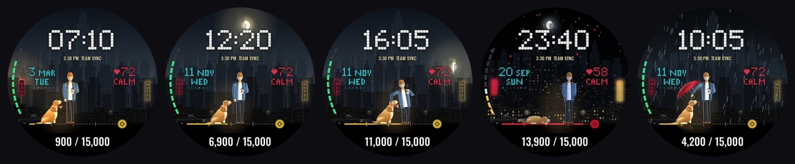
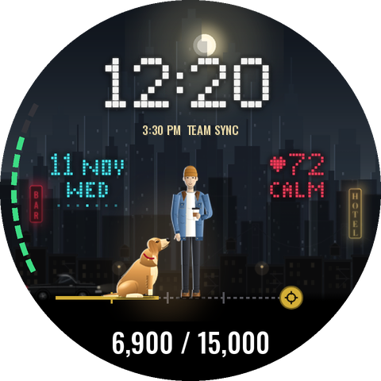
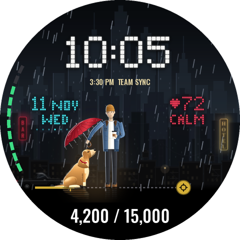
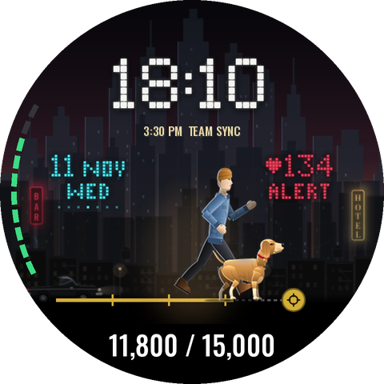
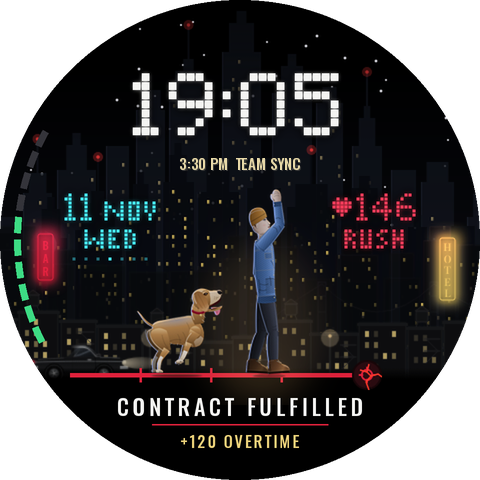
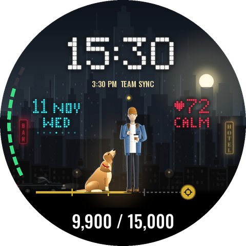
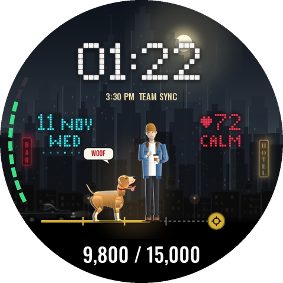
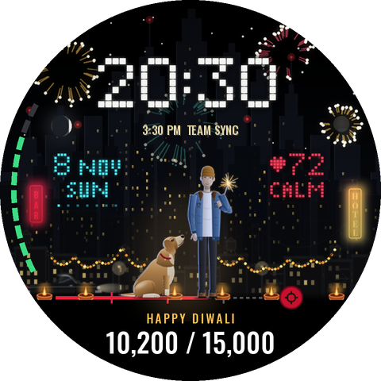
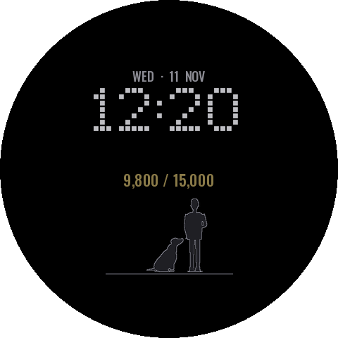

# On the Hunt 🎯 – a noir city watch face for Wear OS



Your steps are today's **bounty**. A guy with a coffee and his golden retriever live in a noir city on your wrist. They react to the time of day, your real weather, your notifications and your workouts. The time, date and heart rate glow like lit windows in the skyline.

Built in Google's **Watch Face Format**, so it works on **Galaxy Watch 4 → 8 / Ultra, Pixel Watch and other round Wear OS 4+ watches**.

---

## Features

| | |
|---|---|
| ⏱ **Time** | Big white **lit-window dot font** with a soft glow; follows your 12/24 h setting. Tap → Alarm |
| 📅 **Date** | Cyan dot text on the left: day and month, the weekday, and a Sun–Sat row of windows with today lit. Tap → Calendar |
| 💓 **Heart rate** | Red dot text on the right; the heart beats at your actual pulse. **CALM** → **ALERT** (100+) → **RUSH** (140+). Tap → Heart rate |
| 🔋 **Battery** | A colour-coded arc on the left edge: green, yellow below 50 %, red below 20 % (blinks). Breathes while charging |
| 🎯 **Steps** | Just your steps and goal; the two of them move along a trail with 25 / 50 / 75 % milestones |
| 📌 **Under the time** | A complication slot: your next calendar event by default, change it in Customize |
| 🚶 **Raise your wrist** | They walk in together, then the dog sits and looks up at him |
| 👆 **Tap them** | He crouches to **pat** the dog · flips a **coin** the dog follows with its eyes · takes a **sip of coffee** |
| 🎭 **They react** | Morning yawn and a steaming cup · umbrella in rain and storms · scarf and breath in snow · panting in the heat · jogging together during a workout · the dog asleep late at night · a comic **"WOOF"** for notifications · leaning on the lamp post when behind pace |
| 🎉 **Contract fulfilled** | Goal reached → fist pump, the dog bounces, **CONTRACT FULFILLED** and your **+OVERTIME** steps |
| 🪔 **Festivals** | Diwali (string lights, diyas, fireworks, a sparkler), Christmas, New Year's Eve fireworks |
| ☀️🌙 **Sun, moon & weather** | The sun crosses the sky with the real time, golden light in the morning and evening, the moon in today's real phase; live rain, storms, snow, fog and clouds |
| 🌑 **Always-on** | A calm, dim screen: dot-font time, date, steps and their silhouette |

| Day | Night | Rain | Workout | Contract fulfilled |
|---|---|---|---|---|
|  |  |  |  |  |

| The pat | Coin flip | Notification | Diwali | Always-on |
|---|---|---|---|---|
|  |  |  |  |  |

> Screenshots are renders of the face; on your wrist it's live and animated. The [demo video](media/demo.mp4) and GIF are from v2.6, so they show the older look.

---

## Install

1. Download **`OnTheHunt-watchface-v2.9.2.apk`** from the [**Releases**](../../releases) page.
2. Follow **[INSTALL.md](INSTALL.md)**: about 10 minutes the first time. Do it **from your Android phone with a free app (no computer needed)**, or with one `adb install` command from Windows, macOS or Linux.
3. On the watch: touch and hold the face → swipe to **+ Add watch face** → **On the Hunt**.

**Requirements:** round Wear OS 4+ watch (Galaxy Watch 4 or newer on current software, Pixel Watch, etc.). Weather, moon phase, heart rate and step goal come from your watch (Samsung Health / Google Fit and the weather service).

---

## Build it yourself

The watch face has **no code**; it's an XML file plus images and fonts.

```
watchface/src/main/
  AndroidManifest.xml
  res/raw/watchface.xml      ← the whole face (Watch Face Format v2)
  res/drawable/*.png         ← artwork (characters, dog, city, skies, sun, moon, weather, festivals)
  res/font/*.ttf             ← Oswald (SIL OFL) + the Hunt Dots fonts (made for this face)
tools/                       ← Python scripts that generate the XML, fonts and artwork
media/                       ← demo GIF / video (v2.6)
```

- Regenerate the XML: `python3 tools/make_watchface_xml.py`
- Regenerate the dot fonts: `python3 tools/dotfont.py`
- Re-render the artwork: see [tools/README.md](tools/README.md)
- Package with Android build tools (`aapt` or Gradle), then sign with **your own** key (`apksigner`).

Validate against the official schema from [google/watchface](https://github.com/google/watchface).

---

## Credits & licences

- **Design, characters, dog, city art:** © John Jitto M. Artwork licensed under **CC BY-NC-SA 4.0** (see [LICENSE-ARTWORK](LICENSE-ARTWORK)): share and remix with credit, not for sale.
- **Scripts & XML:** MIT (see [LICENSE](LICENSE)). The **Hunt Dots** fonts are original, generated by `tools/dotfont.py`, and MIT too.
- **Fonts:** [Oswald](https://fonts.google.com/specimen/Oswald) on the face; [Bebas Neue](https://fonts.google.com/specimen/Bebas+Neue) and Oswald Regular in the preview/video tools. All SIL Open Font License 1.1 (see `fonts-licenses/`).
- Original characters and setting. Not affiliated with or endorsed by any film studio, Samsung or Google.

Provided **as-is**: a personal project, not an official app. Install at your own risk.
